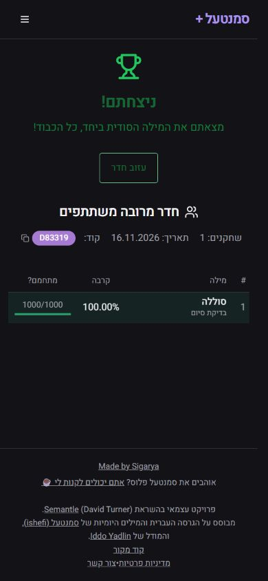
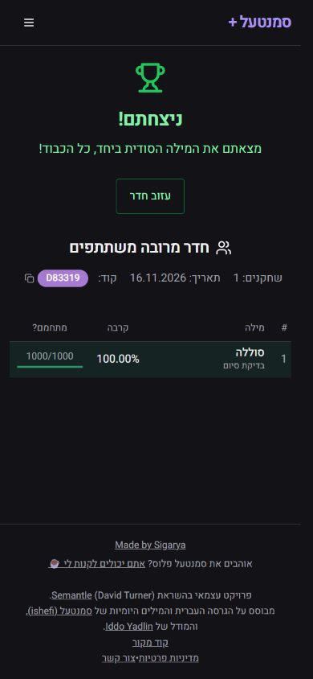

# Visual refinement and QA — 17 November 2026

Branch: `redesign/visual-ux-refresh`; starting commit: `4f74fa4` (`Design tweaks`).
The starting working tree was clean. The rejected journal redesign was absent.
No SEO changes, dependencies, deployment, default-branch edits or gameplay-rule changes.

## Problems fixed

- Dialog headings had unequal RTL padding and close icons were not centered in their touch targets.
- Form boundaries were too faint, especially in dark mode. Input-specific border tokens now distinguish editable fields from structural dividers.
- Dark validation text and multiplayer success text lacked contrast. Success was checked with an actual solved room.
- Reading/contact page titles used a different content width from their body sections.
- Tablet navigation had unnecessarily large gaps. Mobile controls and authentication mode links now have consistent 44px touch targets.
- Login email labels collided with the contact form's `email` ID when its dialog opened above that page. IDs are now distinct; browser accessibility inspection confirms the label.
- Email/password direction and autocomplete hints were missing. No authentication credentials were entered or changed during testing.
- Escape closed the mobile menu without explicitly restoring focus. It now returns focus to the menu button.
- Guess spinners lost their accessible button name; pending buttons now expose their name and busy state. Spinner color follows the button foreground.
- The solo completion screen nested a button inside a link; it now uses the existing asChild pattern.
- Room-code copying had a small target; it now has a 44px target and an explicit accessible label.
- Refreshing from an older puzzle could replace the daily puzzle's saved progress with an empty game. Initialization now recovers the daily puzzle's existing per-date save while retaining the existing default-puzzle behavior.

## Verification actually performed

| Viewport | Visual inspection |
| --- | --- |
| 360 × 800 (also 844 high) | Populated gameplay, shortcuts, history table, login dialog |
| 390 × 844 | Gameplay empty and populated, validation, contact, About, Privacy, empty leaderboard, multiplayer lobby/room, success |
| 430 × 844 | Populated dark gameplay |
| 768 × 1024 | Populated gameplay/navigation, help dialog before and after |
| 1366 × 900 | Populated dark gameplay |
| 1920 × 1080 | Populated dark gameplay |
| 390 × 500 | Registration dialog in reduced height; dialog remained within viewport and scrollable |

Document-width checks at the six requested widths found no horizontal overflow.
Some initial browser captures after rapid resizing were clipped/black. These were not treated as successful visual evidence; the affected desktop/tablet captures were recovered and inspected again.

### Functional flows

- Ten saved daily guesses, including a close result (rank 998), were inspected.
- Invalid `abc` produced the existing Hebrew-only validation message in both themes.
- Duplicate `סוללות` did not add a row and restored input focus.
- Refresh preserved the daily ten-guess game.
- Calendar selection of 15/11/2026 filtered history to one row; playing it opened an empty historical game.
- A real guess `בית` in that historical game returned 14.62%, displayed in the results, and returned input focus.
- Refreshing from that historical puzzle recovered the original daily game with all ten guesses after the persistence fix. The historical puzzle's own guess also remained available on returning through history.
- History pagination advanced to 17/10/2026 as the first row on the second page and returned to the first page.
- Login/register dialogs opened, switched modes and closed. Email's accessible label was confirmed over Contact; help close returned focus to its trigger.
- Mobile menu opened, navigated, switched themes, and closed with Escape while returning focus to its trigger.
- Temporary room BD840E: two participants joined; `חשמל` returned 54.56% and synchronized with player name in the other client. Both participants left normally.
- Temporary room D83319: a real correct guess `סוללה` reached the success state (100%, rank 1000). Success was inspected in dark and light themes, then the participant left normally.
- After room tests the solo daily game still contained all ten original guesses. Test rooms were not manually deleted from the backend.

### Code checks

- `npx tsc --noEmit -p tsconfig.app.json`: passed.
- `npm run build:spa`: production Vite build and PWA generation passed.
- `git diff --check`: passed.
- `npm run lint -- --quiet`: failed with 21 errors and 134 warnings. The npm invocation ran the repository lint command without filtering warnings. All 21 errors were compared with the same files at HEAD using ESLint; there were no new errors.
- No test script or existing automated test suite was found in package.json.
- Existing reduced-motion rules remain in place; OS-level reduced-motion emulation was not tested.

## Remaining limits

Physical Android/iOS keyboard, safe-area behavior, installed-PWA installation/update flows, authenticated profile/statistics/admin screens, actual sign-in/registration, populated leaderboard, and solo completion/replay/exploration were not exercised end to end. Contact was visually inspected; no message was sent. Short-height dialog testing is not a substitute for testing a physical virtual keyboard. Long-session checks used ten guesses, not hundreds.

## Files modified

- `src/index.css`: geometry, density, form tokens, navigation and feedback refinements.
- `src/components/ui/dialog.tsx`: RTL heading and close-target alignment, title line height.
- `src/components/ui/button.tsx`: consistent outline border.
- `src/components/ui/alert.tsx`: legible light/dark destructive feedback.
- `src/components/Header.tsx`: Escape focus restoration.
- `src/components/LoginForm.tsx`: unique field IDs, direction, autocomplete, error/live feedback and mode-switch touch target.
- `src/components/RegisterForm.tsx`: direction, autocomplete, error/live feedback and mode-switch touch target.
- `src/components/GameBoard.tsx`: accessible pending button/spinner, exploration label and completion-link markup.
- `src/components/MultiplayerGameBoard.tsx`: room-code target, pending button semantics and dark success contrast.
- `src/context/GameContext.tsx`: daily per-date progress recovery after historical refresh.

## Screenshots

The clearest same-state comparison:

| Before | After |
| --- | --- |
|  |  |

Other useful evidence: `before-help-768.jpg` / `after-help-768.jpg`, `after-contact-dark-390.jpg`, `after-empty-390.jpg`, `after-room-390.jpg`, `after-room-success-light-390.jpg`, and `after-game-{360,390,430,768,1366,1920}.jpg`.

## Mobile home follow-up

The date and help action now share a context row, with the two game-navigation links below it. Help is outside the navigation group. The date is 14px with a clearer numeric weight. Footer content is grouped into author/support, credits, and navigation.

The install banner always exposes home-screen addition plus Google Play. A browser-provided install event opens the native prompt; without it, device-specific manual instructions appear. HTTP LAN addresses show an explanation that native PWA installation needs a secure context. Actual native installation was not exercised locally.

Dismissal is in-memory for the current page visit, not persisted for seven days. Browser verification confirmed it stays hidden during client-side navigation and returns after reload. An appinstalled listener also hides the banner on successful installation.

Reviewed mobile at effective widths 360 and 390px and desktop at 1280px, in light/dark, including help and install-instruction dialogs. No document overflow at 360/390. TypeScript, build:spa and diff checks passed. Screenshots: mobile-home-install.jpg, mobile-footer.jpg, desktop-home-install.jpg, desktop-footer.jpg.
